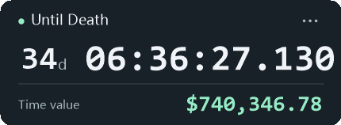

# Death Countdown

[简体中文](README.md) · English

A floating Windows countdown that puts a price on every second. Pick an event, set a deadline and a rate, and watch the remaining time and its value tick down to the millisecond.

**[Download DeathCountdown.exe](https://github.com/jk-eric/death-countdown/releases/latest/download/DeathCountdown.exe)** and double-click it to start. Runs locally with Windows Forms and .NET Framework 4.x.

## Set your target

1. Click **···** or right-click the widget, then choose **Set countdown target**. Enter an event name and either a date and time in Beijing time (UTC+8) or a number of days from now.
2. Choose **Set rate** to enter an amount per second. **Show value of remaining time** counts down. **Start counting earnings from zero** counts up until the deadline. Changing the rate preserves earnings already accrued.
3. Drag the widget to move it or drag an edge to resize it. The menu also includes **Restore default size**, **Always on top** and an opacity slider.

## Language and currency

Open **··· → Language and currency**. Choose **System default**, **简体中文** or **English**, then choose **CNY (¥)** or **USD ($)** separately. The system option uses Chinese on a Chinese Windows display language and English otherwise.

A new installation uses CNY when the Windows regional format uses yuan and USD elsewhere. Existing settings keep CNY on upgrade. Switching currency changes the unit and keeps your rate and totals at their current numeric values. No exchange rate is applied.

Settings are saved to `%LOCALAPPDATA%\YuanDanCountdown2027\settings.xml`.

## Build

On Windows with the .NET Framework 4.x C# compiler installed, run `.\build.ps1` from the repository directory. The executable is written to `dist\DeathCountdown.exe`.
