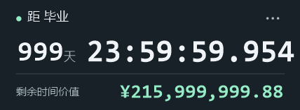

# 桌面倒计时

Windows 桌面悬浮小窗。给毕业、跨年或其他日子设一个目标，把剩余时间显示到毫秒。也可以给每秒定个价，看着剩余金额一点点减少。



## 下载

从 [最新版本](https://github.com/jk-eric/desktop-countdown/releases/latest) 下载 **DesktopCountdown.exe**，双击启动。程序使用 Windows 的 .NET Framework 4.x 和 Windows Forms。

## 使用

- 点右上角 **···** 或右键打开菜单。在「设置倒计时目标」里填写事件名，选择北京时间，或输入从现在开始倒数的天数。
- 在「设置费率」里输入每秒金额，例如 `1` 或 `0.1`。默认显示剩余时间价值，也可从零开始累计。累计期间改费率，已有金额会保留。
- 拖动窗口中间可以移动，拖四边或四角可以自由调整宽高。选「恢复默认大小」可回到初始尺寸。
- 菜单里可以切换窗口置顶，拖动不透明度滑块可实时预览效果。

到达目标时，倒计时停在零，累计金额停在目标时刻。目标、费率和窗口设置保存在当前 Windows 用户的 `%LOCALAPPDATA%\YuanDanCountdown2027\settings.xml`，重开时自动恢复。

## 从源码构建

在 Windows PowerShell 中进入仓库目录并运行：

```powershell
.\build.ps1
```

脚本调用 .NET Framework 自带的 C# 编译器，生成 `dist\DesktopCountdown.exe`。
